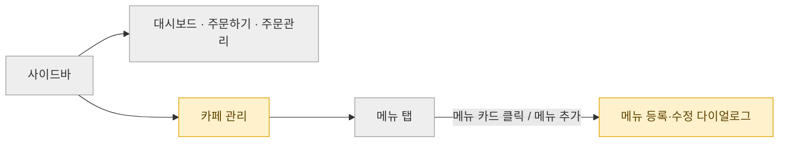
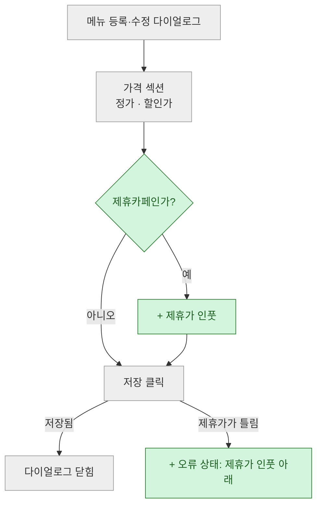

# 화면흐름 문서 (flow.md)

`sdd:flow` 가 쓰는 화면흐름 문서의 모양이다. pug-frame 와이어프레임을 그리기 전에 "어느 화면에 무엇이 끼어들고, 그 값을 무엇으로 정하는가" 를 글과 흐름도로 먼저 확인하는 문서다. 성격은 화면설계서이고, 요구사항정의서(`requirements.md`)와 기능명세서(`design.md`) 사이의 일을 나눠 맡는다.

`references/spec-format.md` 를 모두 따르고, 아래 예외 하나를 둔다.

- 마커는 화면 표의 「근거」 칸에만 붙인다. 근거가 요구사항 번호나 결정 ID 뿐이면 마커를 붙이지 않는다. 마커는 그 요구사항 문서 자리에 이미 있기 때문이다. 요구사항에 없는 것을 LLM 이 채웠으면 `@초안`, 지금 화면을 확인하지 못하고 짐작했으면 `@가정` 을 붙인다

## 그리는 범위

이 문서는 사용자가 보는 화면과 사용자가 하는 행동만 그린다.

- 그린다: 화면 이동, 화면 요소의 추가·삭제·수정, 화면에 보이는 값의 정의, 화면이 보이는 조건, 행동의 결과로 사용자가 보는 화면 상태(저장됨, 어느 칸 아래 어떤 오류 문구, 빈 상태)
- 그리지 않는다: 저장 버튼을 누른 뒤 서버가 무엇부터 따지는지, 무엇을 기록하는지, 어떤 API 를 부르는지. 이것은 `design.md` 가 맡는다
    - 예: 메뉴 저장 흐름에 「1원 미만인가?」「할인가보다 높은가?」 마름모를 줄줄이 그리지 않는다. 「저장 클릭」에서 결과 화면 3개(다이얼로그 닫힘, 제휴가 아래 오류, 할인가 아래 오류)로 바로 잇고, 어떤 경우에 오류가 뜨는지는 화면 표에 쓴다
    - 화면에 나오지 않는 요구사항(변경 기록 남기기 등)은 그 화면 절 표 아래에 "화면에 나오지 않아 `design.md` 에서 다룬다" 한 줄로만 남긴다
- 배치, 크기, 모바일 모양은 pug-frame 단계로 미룬다

## 한 번만 쓴다 (세 문서 사이)

- 요구사항 문서의 규칙·수치·용어를 옮겨 적지 않는다. `요구사항 {n} 조건 {m}`, 결정 ID, 용어 이름으로 가리킨다. 화면 표의 「보여 줄 값과 동작」에는 그 화면에서 무엇이 보이는지만 쓰고, 규칙은 근거로 가리킨다
- 화면 요소의 값·문구·조건은 화면 표 한 곳에만 쓴다. 흐름도 노드에는 요소 이름과 짧은 상태만 둔다. 흐름도 위 글은 "「{화면}」 표를 그림으로 옮긴 것" 과 읽는 법만 적는다
- 요구사항이 둘 이상이면(예: 「제휴카페」·「제휴결제」) 기준 줄에서 짧은 이름을 정하고, 근거 칸은 `「제휴결제」 요구사항 6 조건 3` 처럼 쓴다
- 화면을 그리다 드러난 **사용자에게 보이는 새 규칙**(새 탭이 누구에게 보이는가 등)은 화면 표에 `@초안` 으로 쓰고, 끝맺음에 요구사항 문서에 올릴 문장으로 제안한다 (역반영). 문구, 열 순서, 오류 위치처럼 화면 안의 세부는 이 문서에서 정한다

## 결정 표기

spec-format 「필요한 결정」 모양에 아래를 더한다.

- 그룹 문자는 `M`~`R` 이다 (spec-format 「열린 결정」). 그룹마다 5개 이하
- 결정 제목 끝에 `->` 를 둔다. 마스터가 그 옆에 답을 적는 자리다
- 정해진 결정은 표로 둔다: `| ID | 질문 | 마스터 답 | 반영한 곳 |`. 답이 바뀌면 이전 답을 지우지 않고 `"a안" → "{새 답}"` 처럼 옆에 붙이고, 다른 결정으로 바뀌었으면 `(M4로 바뀜)` 을 붙인다
- 요구사항 문서의 열린 결정에 걸린 화면은 그 결정의 추천안으로 그리고, 근거 칸에 `@가정 ({결정 ID} 추천안)` 을 붙인다. 다른 옵션이면 바뀌는 화면 요소를 표 아래에 한 줄로 적는다

## 문서 구성 (이 순서)

해당 없는 절은 지우지 말고 "해당 없음 — {이유 한 줄}" 로 남긴다. 요약·결론 절은 두지 않는다.

### 제목과 기준

- 제목: `# {기능} 화면흐름`. 기능 이름은 요구사항 문서 제목에서 가져온다
- 기준 줄(불릿)
    - 날짜
    - 입력: 요구사항 문서 경로와 짧은 이름. 와이어프레임을 받았으면 그 경로
    - 지금 범위: 이 문서가 다루는 화면 묶음. 나머지는 「다음 차례」에 있다고 적는다

### 필요한 결정

`### 열린 결정`, `### 정해진 결정` 두 소절. 없으면 "없음".

### 읽는 법

아래 네 가지를 불릿으로 적는다.

- 그리는 범위 한 문장: "이 문서는 사용자가 보는 화면과 행동만 그립니다. 저장 뒤 처리와 기록은 `design.md` 에서 다룹니다"
- 바뀜 표기: **+** 추가, **-** 삭제, **~** 수정
- 노드 색: 회색 AS-IS, 초록 TO-BE 추가, 노랑 TO-BE 수정. 「경로」 그림의 노랑은 "안에 바뀌는 곳이 있는 화면" 이다
- 화면 글자: 지금 화면의 이름을 쓴다. 지금 화면 이름과 요구사항 용어가 다르면 둘을 잇는 한 줄 (예: 어드민의 「할인가」 칸이 요구사항의 판매가)

### 화면 묶음 (`## {화면 묶음}`)

화면 묶음 하나는 한 주체가 쓰는 한 앱이다 (예: 카페 고객사 어드민, 임직원 웹오더, POS). 묶음마다 `##` 헤딩 하나를 두고, 아래 소절을 이 순서로 둔다.

- 첫 줄: 이 화면을 쓰는 주체와 권한. 이 주체가 할 수 없는 일이 요구사항에 있으면 함께 적는다
- `### 화면 흐름`: 「흐름도」 규칙대로 「경로」 하나와 흐름 여러 개
- `### {화면 이름}`: 바뀌는 화면마다 하나. 「화면 표」 규칙을 따른다
- `### 와이어프레임에서 고칠 곳`: 와이어프레임을 입력으로 받았을 때만. 받지 않았으면 "해당 없음 — 와이어프레임을 받지 않았다"
- `### 범위 밖`: 이 묶음에서 다루지 않는 화면과 그 화면이 있는 곳(다른 묶음, 다른 문서), 마스터 요청에 없어서 넣지 않은 동작

### 다음 차례

이 문서에서 아직 쓰지 않은 화면 묶음을 차례대로 한 줄씩. 묶음마다 걸린 요구사항 번호를 붙인다. 모두 썼으면 "없음".

## 흐름도

- 한 코드 블록에 한 흐름만 그린다. 화면 묶음 전체를 그림 하나에 몰지 않는다
    - 「경로」: `#### 경로` 아래 ```mermaid `flowchart LR` 하나. 진입점(로그인, 사이드바)에서 바뀌는 화면까지 가는 길이다. 바뀌지 않는 형제 화면은 노드 하나로 묶는다 (예: `대시보드 · 주문하기 · 주문관리`)
    - 흐름: `#### {흐름 이름} 흐름` 아래 ```mermaid `flowchart TD` 하나. 사용자가 한 번에 하는 일 하나가 흐름 하나다 (예: 메뉴 등록·수정 흐름, 제휴정산 탭 흐름)
- 색은 아래 세 줄로 고정하고, 모든 흐름도에 세 줄을 다 둔다. 다른 색은 쓰지 않는다

```text
  classDef asis fill:#eeeeee,stroke:#9e9e9e,color:#333333
  classDef add fill:#d4f5dd,stroke:#2e7d32,color:#1b5e20
  classDef mod fill:#fff1cc,stroke:#e0a100,color:#5d4300
```

- 모든 노드에 `:::asis`, `:::add`, `:::mod` 중 하나를 붙인다. 추가 노드 라벨은 `+ ` 로, 수정 노드 라벨은 `~ ` 로 시작한다
- AS-IS 흐름을 회색으로 먼저 그리고, 새 노드가 그 사이 어디에 끼어드는지 보이게 잇는다. 새 화면만 따로 떼어 그리지 않는다
- 마름모(`{ }`)는 행동 전에 화면이 갈리는 조건에만 쓴다 (예: 「제휴카페인가?」 → 인풋이 보이는가). 행동 뒤에는 마름모 대신 결과 라벨이 붙은 화살표로 결과 화면에 잇는다 (예: `SV -- "저장됨" --> OK`)
- 노드 라벨은 큰따옴표로 감싼다. 줄바꿈은 `<br/>` 다

## 화면 표

바뀌는 화면마다 소절 하나. 소절 첫 줄은 경로(`매출 · 정산 > 정산 현황 탭 > 일별 행 클릭`)와 이 화면이 통째로 새로 생기는지, 일부만 바뀌는지다.

| 요소 | 바뀜 | 보여 줄 값과 동작 | 언제 보이나 | 근거 |
| --- | --- | --- | --- | --- |

- 요소: 화면 요소 이름과 위치 (예: `제휴정산 열 (당일 정산액 오른쪽)`). 오류는 `오류 상태 ({칸} 아래)` 로 칸마다 한 행
- 바뀜: `+`, `-`, `~` 중 하나
- 보여 줄 값과 동작: 값의 정의(무엇을 어느 기준으로 세는가), 비었을 때 보이는 것, 누르면 일어나는 일, 문구 원문
- 언제 보이나: 그 요소가 보이는 조건 (예: 제휴카페, 제휴가를 넣었을 때, 저장할 때)
- 근거: 「한 번만 쓴다 (세 문서 사이)」의 가리키는 법과 맨 위 마커 예외
- 표 아래 불릿: 표 칸에 넣기 긴 기준(달을 나누는 시각, 취소가 어느 달에 보이는가)과 화면에 나오지 않아 `design.md` 로 넘기는 요구사항

## 와이어프레임에서 고칠 곳

와이어프레임 파일을 받았을 때만 쓴다. 와이어프레임 파일은 고치지 않고 목록만 남긴다.

| 행 | 지금 | 고칠 내용 | 근거 |
| --- | --- | --- | --- |

- 행: 와이어프레임 파일의 행 번호. 새로 그려야 하면 "없음"
- 요구사항과 어긋나는 것(값의 기준, 옛 용어), 빠진 것(오류 상태, 취소 줄), 결정으로 지워지는 시나리오를 모두 담는다
- 결정에 걸린 행은 근거에 결정 ID 를 적는다. 열린 결정에 걸린 행이 있으면 소절 첫 줄에 "{ID} 답에 따라 바뀝니다" 를 적는다

## 완성

아래를 모두 채우면 「완성」이다. 「완성」이면 이 문서로 pug-frame 와이어프레임을 그리거나 고칠 수 있다.

- 「열린 결정」이 비어 있다
- `(작성 중)` 이 없다
- 모든 흐름도가 mermaid-cli 로 오류 없이 그려진다
- 요구사항 문서에서 화면에 보이는 동작을 정한 인수 조건이 모두 어느 화면 표의 근거 칸이나 「범위 밖」에 있다

## 형식

````markdown
# {기능} 화면흐름

- 날짜: 2026-11-08
- 입력: `~/.sdd/{리포}/{폴더}/requirements.md` (이하 「제휴카페」), 와이어프레임 `{경로}`
- 지금 범위: 카페 고객사 어드민. 나머지는 「다음 차례」에 있습니다.

## 필요한 결정

### 열린 결정

#### M 노출

- **M1. 제휴정산 탭이 어느 카페에 보일지** ->
    - 예시: 11월 20일에 제휴를 끈 카페 → a안은 12월에도 탭이 보여 11월분을 확인, b안은 탭이 사라짐
    - a. 한 번이라도 켰던 카페 — 끈 뒤에도 마지막 보전액을 본다
    - b. 지금 켜져 있는 카페 — 조건이 단순하다. 끈 카페의 문의는 운영자가 답한다
    - 추천: @초안 a안 — 끈 카페가 정산 금액을 화면에서 확인할 길이 남는다
    - 걸린 곳: 제휴정산 탭 「제휴정산 탭」 행, 제휴정산 탭 흐름

### 정해진 결정

없음

## 읽는 법

- 이 문서는 사용자가 보는 화면과 행동만 그립니다. 저장 뒤 처리와 기록은 `design.md` 에서 다룹니다.
- 바뀜 표기: **+** 추가, **-** 삭제, **~** 수정
- 노드 색: 회색 AS-IS, 초록 TO-BE 추가, 노랑 TO-BE 수정. 「경로」 그림의 노랑은 안에 바뀌는 곳이 있는 화면입니다.
- 어드민의 「할인가」 칸이 「제휴카페」의 판매가입니다.

## 카페 고객사 어드민

주체는 카페담당자입니다. 카페담당자는 제휴카페를 직접 켜거나 끄지 않습니다(「제휴카페」 요구사항 3 업무 규칙).

### 화면 흐름

#### 경로



#### 메뉴 등록·수정 흐름

「메뉴 등록·수정 다이얼로그」 표를 그림으로 옮긴 것입니다. 오류가 뜨는 경우는 표에 있습니다.



### 메뉴 등록·수정 다이얼로그

경로는 카페 관리 > 메뉴 탭 > 메뉴 카드 클릭입니다. 가격 섹션 일부만 바뀝니다.

| 요소 | 바뀜 | 보여 줄 값과 동작 | 언제 보이나 | 근거 |
| --- | --- | --- | --- | --- |
| 제휴가 인풋 | + | 숫자만 받음. 비워 두면 임직원에게도 할인가로 팔림 | 제휴카페 | 「제휴카페」 요구사항 4 조건 1·3 |
| 오류 상태 (제휴가 인풋 아래) | + | 저장되지 않고 "제휴가는 1원 이상, 할인가 이하로 넣어 주세요" 가 뜸. 다이얼로그는 열린 채로 남음 | 저장할 때 | 「제휴카페」 요구사항 4 조건 2, 문구와 위치는 @초안 |

- 제휴가를 바꾼 시각과 사람을 남기는 일(「제휴카페」 요구사항 4 조건 8)은 화면에 나오지 않아 `design.md` 에서 다룹니다.

### 와이어프레임에서 고칠 곳

| 행 | 지금 | 고칠 내용 | 근거 |
| --- | --- | --- | --- |
| 530 | 라벨 "제휴할인가" | 라벨 「제휴가」 | 「제휴카페」 용어 |
| 없음 | 저장 거부 | 제휴가 인풋 아래 오류 상태 그림 추가 | 「제휴카페」 요구사항 4 조건 2 |

### 범위 밖

- 제휴카페를 켜고 끄는 화면은 운영자 화면이라 「아란테 어드민」 묶음에서 다룹니다(「제휴카페」 요구사항 3).

## 다음 차례

- 임직원 웹오더 — 주문서와 내 정보(「제휴결제」 요구사항 5)
````
